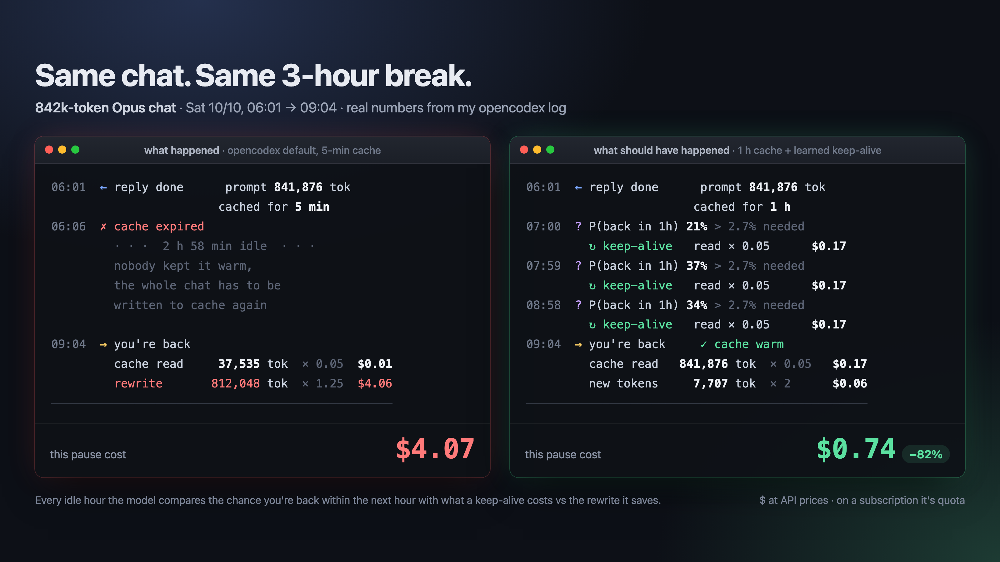
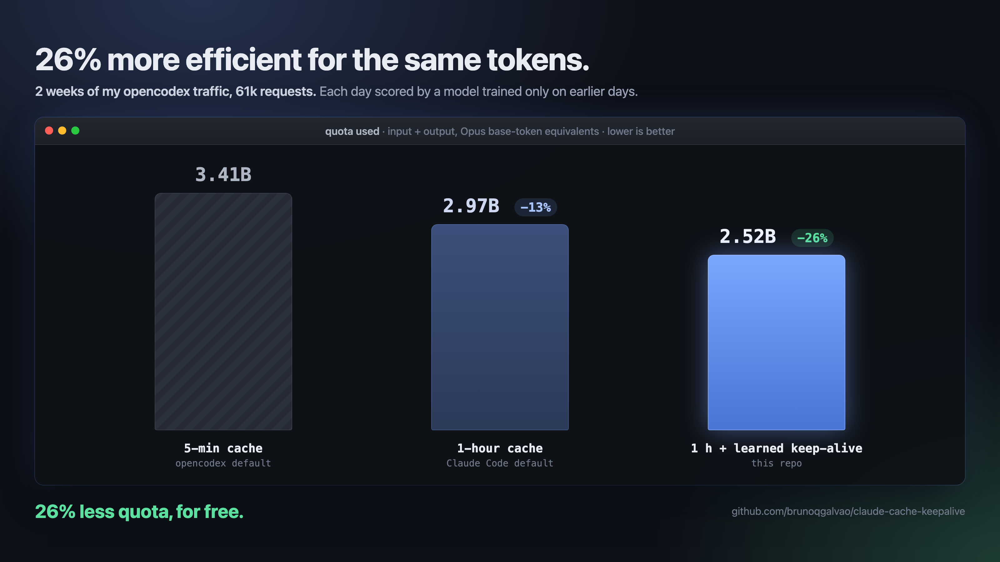
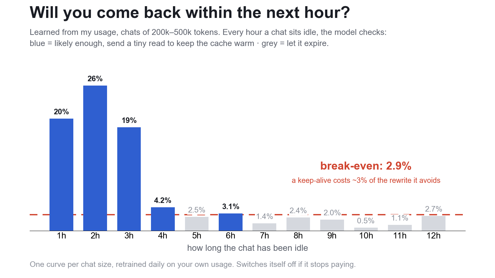

# claude-cache-keepalive

Free tokens, sometimes. Anthropic's prompt cache expires after 5 minutes (or 1 hour) without use. Step away from a long Claude chat and the next turn rewrites the whole context, often hundreds of thousands of tokens.

This keeps idle chats cached. Shortly before a chat's 1-hour cache expires, it re-sends the chat's last request and cuts it off at the first event. That reads the cache at the read price (0.05x input on Opus 5.5) instead of rewriting it at 2x, and restarts the hour. It learns how long to keep doing this from your own usage, watches whether it pays, and switches itself off if it stops paying.

Two setups:

- **opencodex** (Codex with Claude models): a small patch to opencodex. Also switches opencodex from its 5-minute default to the 1-hour cache, which on its own saves tokens.
- **Claude Code**: a local pass-through proxy. Claude Code's main chat already uses the 1-hour cache on a subscription; this keeps it warm past the hour.



## Install with your agent

Point Codex or Claude Code at this repo and ask it to install. For example:

> Install https://github.com/brunoqgalvao/claude-cache-keepalive for opencodex (or: for Claude Code). Follow its README, then show me the dashboard.

Notes for the agent doing the install:

- opencodex: run `python3 opencodex/install.py --restart-when-quiet` from the repo root. It needs opencodex installed with npm and Claude accounts logged in through OAuth. The flag restarts opencodex once no chat has been active for 10 minutes, so it does not cut off the chat running the install. Then open http://127.0.0.1:8797.
- Claude Code: run `python3 claude-code/install.py`, then tell the user to restart open Claude Code sessions. Open http://127.0.0.1:8798.
- Both installers are idempotent; rerun after an opencodex update. Uninstall with `--uninstall`.

## What it saved me



Backtest on two weeks of my opencodex traffic (61k requests, Opus 5.5, Claude subscription). Each day is scored by a model trained only on the days before it, the way the daily retrain works live. Quota is input plus output in Anthropic's price ratios (5-min write 1.25x, 1-hour write 2x, read 0.05x, output 5x). Reproduce with `python3 analysis/backtest_walkforward.py --days 21 --test-days 14`.

| | quota used | vs 5-minute default | vs 1-hour cache |
|---|---|---|---|
| 5-minute cache (opencodex default) | 3.41B | | |
| 1-hour cache only (Claude Code's default) | 2.97B | -13% | |
| 1-hour cache + learned keep-alive | 2.52B | **-26%** (35% more usage) | **-15%** (18% more usage) |

Week by week, the 1-hour cache alone went from 27% less than the 5-minute cache to about even (1% more): it costs 0.75x extra on every turn's new tokens and only pays back when a turn is followed by a 5–60 minute pause, so it wins when more than about 2.4% of turns are (mine: 3.4%). The keep-alive saved a steady 15% on top of the 1-hour cache in both weeks. Keep-alives cost 67M tokens and avoided 512M of rewrites.

The replay models each request's cache read from its real size and the time since the previous one; checked against the reads actually logged, it is within 0.6% for 5-minute-era traffic and 0.1% for 1-hour-era traffic. Live since switching (44 h): 16% less than the 5-minute replay, 8% less than the 1-hour replay. On a subscription this is quota, not dollars; Anthropic doesn't publish exactly how cache tokens count against limits.



Details, methods and the things that did not work: [analysis/RESULTS.md](analysis/RESULTS.md).

## Setup: opencodex

Requires opencodex installed with npm and Claude accounts logged in through OAuth.

```sh
git clone https://github.com/brunoqgalvao/claude-cache-keepalive
cd claude-cache-keepalive
python3 opencodex/install.py
ocx restart
```

If chats are running, use `python3 opencodex/install.py --restart-when-quiet` instead of `ocx restart`: a one-shot background job waits until no chat has been active for 10 minutes, asks opencodex for its graceful restart, then removes itself.

The installer:

1. sets `cacheRetention` to `"long"` (1-hour cache) in `~/.opencodex/config.json`
2. copies `cache-keepalive.ts` into opencodex and adds four small hooks to `src/adapters/anthropic.ts` (original saved as `anthropic.ts.orig`)
3. tunes a policy on your last 14 days of `~/.opencodex/usage.jsonl`
4. on macOS, starts a dashboard at http://127.0.0.1:8797 and a daily monitor

Switching to the 1-hour cache makes each open chat rewrite its cache once (5-minute and 1-hour caches are separate). An opencodex update replaces the patched file: run `python3 opencodex/install.py` again afterwards. The patch runs on opencodex 2.73 and applies cleanly to 2.87.

## Setup: Claude Code

```sh
python3 claude-code/install.py
```

Then restart open Claude Code sessions. The installer starts the proxy on 127.0.0.1:8796 (macOS launchd keeps it running) and adds two entries to the `env` block of `~/.claude/settings.json`:

- `ANTHROPIC_BASE_URL=http://127.0.0.1:8796`: Claude Code's requests go through the proxy, which relays them to api.anthropic.com unchanged and streams responses back.
- `CLAUDE_CODE_PROMPT_CACHE_TTL=1h`: 1-hour cache for the main chat. Claude Code does this by default on a subscription, but in my tests it wrote 5-minute caches behind a custom base URL. Keep-alives only apply to 1-hour caches. Subagents keep their 5-minute default.

The installer seeds the usage log from your existing Claude Code transcripts (`~/.claude/projects`, last 14 days), so the policy is trained on your history from the first minute. If that history says keep-alives would not pay (short sessions, few long pauses), they start switched off: the proxy still relays everything with the 1-hour cache, and keep-alives switch on by themselves once a daily retune says they pay. With fewer than 200 requests to learn from, it keeps chats over 40k tokens alive for up to 4 hours.

The dashboard is at http://127.0.0.1:8798. If the proxy is not running, Claude Code cannot reach Anthropic, so uninstall it before removing the files.

## How it learns and when it turns off

`tools/tune.py` replays your recent conversations and fits two policies, then keeps whichever saves more on your data:

- **Probability rule.** For each hour a chat has been idle (1 to 24) and each chat size (20k, 80k, 200k, 500k+ tokens), it counts how often you came back within the next hour. Sparse cells are shrunk toward the overall rate. A keep-alive is sent when that chance beats break-even: keep-alive cost ÷ rewrite avoided, which is about 2.8% for a big Opus chat and 6% for a 20–80k one.
- **Fixed limit.** "Keep alive up to N hours, only chats over X tokens", the best N and X on your data.

On my opencodex usage the probability rule wins (12.3% of input saved vs 12.0% for the best fixed limit): return chances are 6–37% in the first three idle hours and mostly 1–5% after that, with spikes like the next morning that a fixed limit can't follow. It reruns every day.

`tools/monitor.py` runs daily: it retunes, then measures what keep-alives actually did over the last 72 hours (rewrites avoided on returns after more than 1 hour idle, minus the cost of every keep-alive). If they lost tokens it writes a `disabled` file and keep-alives stop until you run `install.py --enable`. If only the tuner says they would not pay, they stop and come back on by themselves when a later retune says they pay.

I also tried a logistic model with signals from Codex's own session logs. It gained under one point over the simpler rules: a keep-alive costs about 2.5% of a rewrite on a big chat, so it pays whenever there's more than a few percent chance you come back, and the hour-by-size table already captures most of that.

## Dashboard

Three pages, recomputed from the local logs (new log lines are read incrementally, so it stays fast on a large usage log):

- **Savings & live** (`/`): the headline is overall consumption: every request since install priced as it actually ran (keep-alives included), against the same requests under the cache you had before (5-minute for opencodex, 1-hour for Claude Code), as a % and a cumulative chart. Then net saved, rewrites avoided and keep-alive cost, for the last 6 hours up to all time, with a cumulative or per-period chart of savings against cost. Below it, every chat whose cache is warm right now: when it expires, the chance you come back in the hour after its next check against the break-even chance, how long the policy would keep it if you stay away, and what it will do at the next check. Refreshes every 30 s.
- **Decisions** (`/decisions`): every time a chat sat idle for over an hour, graded after the fact. *Paid off*: kept alive and you came back warm. *Wasted*: kept alive and nobody came back warm. *Missed*: you came back cold where keeping it alive until then would have cost less than the rewrite, with the reason it wasn't kept. *Not needed*: let it expire and a keep-alive would not have paid. Each pause shows its net next to the best a policy that knew when you'd come back could have done, and a calibration chart compares the chances the model gave with how often you actually came back.
- **Policy** (`/policy`): the rule in use, why the tuner picked it, the break-even math, the idle-hours × chat-size return table, and the same requests replayed under the 5-minute and 1-hour cache next to what actually happened.

On macOS the installers also add a menu bar item: a bolt with today's net savings, so you can see at a glance that it is on and working. Its menu shows today, the last 24 hours and the total since install, the chats warm right now and when the next keep-alive is due, the last chat a keep-alive saved, and a link to the dashboard. When a return finds its cache warm, the item briefly shows what that saved. It is built from tools/menubar.swift with swiftc (Xcode command line tools); skip it with --no-menubar.

With opencodex the overview also shows your Claude plan meters (this week and the 5-hour window, read from opencodex's own quota cache) and an estimate of where each would be without keep-alives: the meter's used share is spread over what this machine sent in that window, priced in token-equivalents with output at 5x, and the same requests are replayed under the cache you had before. They are drawn as line charts over the whole window, used against the estimate without keep-alives, with the limit line; if the replay crosses 100%, it marks when you would have hit the limit. The dashboard records every new meter reading in plan_history.jsonl and draws them as dots; before the first reading the line is rebuilt from what this machine sent, scaled to the meter. It assumes the plan is only used through opencodex; with several accounts it shows the meters without an estimate.

One conversation can carry several cache contexts (side requests, forks, compacted history); the dashboard follows each one separately, the way the cache and the keep-alive see them. With Codex, chat titles come from `~/.codex` on your machine (opencodex logs a hash of the thread id).

## What it sends and stores

Keep-alives re-send your own last request with your own credentials, from your machine to Anthropic, with `max_tokens` 16 and the connection dropped at the first event. Logs hold token counts, timings and a hash of each conversation's opening, never content. Each keep-alive uses quota (about 0.05x of the chat's context on Opus). A daily cap limits them.

## Uninstall

```sh
python3 opencodex/install.py --uninstall     # add --keep-1h to keep the 1-hour cache setting
ocx restart
python3 claude-code/install.py --uninstall
```

## Caveats

- One user's traffic. Your pauses decide whether this pays; that's why it tunes on your log and monitors itself.
- A chat is identified by its model, its thread (the Codex thread id, or Claude Code's session id), system prompt and first two messages. Earlier versions left out the thread, so chats that opened with the same instructions shared a key and only the last one used was kept alive; rerun the installer to get the fix. If the start of a conversation changes (for example an edited instructions file), the old cache stops matching; the keep-alive notices (the re-read comes back small) and stops for that chat.
- The opencodex patch edits installed source. It is small and marked with `// claude-cache-keepalive`, but read it before running it.

MIT license.
